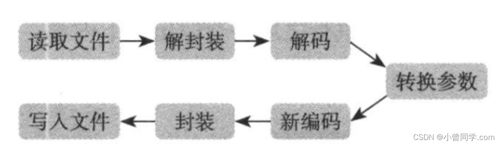

ffmpeg是学习音视频的一把利器，ffmpeg是用于音视频编解码的多媒体开源库，它为开发者提供了丰富了音视频处理的调用接口，在工作中经常用它来实现推拉流，转码等操作。
# ffmpeg安装
可以了解这篇文章 https://blog.csdn.net/weixin_42182599/article/details/125142176?spm=1011.2415.3001.5331
有两种方式安装
## Mac 一键安装
    brew install ffmpeg

## 通过ffmpeg库编译安装
1. git clone git@github.com:FFmpeg/FFmpeg.git

2. cd ffmpeg

3. ./configure --prefix=/usr/local/Cellar/ffmpeg/5.0 --enable-shared --enable-pthreads --enable-version3 --cc=clang --host-cflags= --host-ldflags= --enable-nonfree --enable-libfdk-aac --enable-ffplay --enable-gpl --enable-libaom --enable-libwebp --enable-libx264 --enable-libx265 --disable-indev=jack --enable-videotoolbox --enable-filter=delogo --enable-debug --disable-optimizations --enable-libspeex --enable-hardcoded-tables

4. make && make install

ffmpeg 安装完成之后会有三个可执行程序，分别是ffmpeg、ffplay、ffprobe，这三个也称为 FFmpeg 三剑客，各有各的作用。

# ffmpeg工作流程
1）读取输入源
2）进行音视频的解封装
3）解码每一帧音视频数据
4）编码每一帧音视频数据
5）进行音视频的重新封装
6）输出到目标

